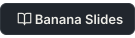

<!-- i18n:hero -->
[//]: # "Banana SlidesはアイデアアウトラインドキュメントカスタムテンプレートからなプレゼンテーションをするためのAIネイティブなPPTアプリですプロンプトからのスライドテンプレートPPTXエクスポートプロジェクトなワークフローローカルのDockerデプロイおよびオンラインのためのクイックスタート/インストール//デモ/API/デプロイ/アーキテクチャ/テスト/スクリーンショットのガイドがされています"
<div align="center">

<a name="readme-top"></a>

<div>
  <a href="./assets/hero-light.png#gh-light-mode-only"></a><a href="./assets/hero-dark.png#gh-dark-mode-only"></a>
</div>

<!-- readme:intro -->
<p>
  モデルをした AI ネイティブな PPT アプリでアイデアをわずかでプレゼンに<br>
  なレイアウトはなでしのVibe PPTをしましょう
</p>
<!-- /readme:intro -->

<!-- readme:languages -->
<p><a href="README.md#gh-light-mode-only"></a><a href="README.md#gh-dark-mode-only"></a><a href="README_EN.md#gh-light-mode-only"></a><a href="README_EN.md#gh-dark-mode-only"></a><a href="README_PT-BR.md#gh-light-mode-only"></a><a href="README_PT-BR.md#gh-dark-mode-only"></a><a href="README_JA.md#gh-light-mode-only"></a><a href="README_JA.md#gh-dark-mode-only"></a><a href="README_KO.md#gh-light-mode-only"></a><a href="README_KO.md#gh-dark-mode-only"></a></p>
<!-- /readme:languages -->

<!-- readme:actions -->
<p>
  <a href="https://bananaslides.online/"></a>
  &nbsp;
  <a href="https://docs.bananaslides.online/#gh-light-mode-only"></a><a href="https://docs.bananaslides.online/#gh-dark-mode-only"></a>
  &nbsp;
  <a href="https://github.com/Anionex/banana-slides/releases/tag/v0.9.0-rc.7#gh-light-mode-only"></a><a href="https://github.com/Anionex/banana-slides/releases/tag/v0.9.0-rc.7#gh-dark-mode-only"></a>
  &nbsp;
  <a href="https://github.com/Anionex/banana-slides#user-content--%E4%BD%BF%E7%94%A8%E6%96%B9%E6%B3%95#gh-light-mode-only"></a><a href="https://github.com/Anionex/banana-slides#user-content--%E4%BD%BF%E7%94%A8%E6%96%B9%E6%B3%95#gh-dark-mode-only"></a>
</p>
<p>
  <a href="https://x.com/anion_ex#gh-light-mode-only"></a><a href="https://x.com/anion_ex#gh-dark-mode-only"></a>
  &nbsp;
  <a href="#user-content-community#gh-light-mode-only"></a><a href="#user-content-community#gh-dark-mode-only"></a>
</p>
<!-- /readme:actions -->

<div>
  <a href="./assets/readme/section-rule-light.svg#gh-light-mode-only"></a><a href="./assets/readme/section-rule-dark.svg#gh-dark-mode-only"></a>
</div>

<p>
  <a href="https://github.com/Anionex/banana-slides/stargazers#gh-light-mode-only"></a><a href="https://github.com/Anionex/banana-slides/stargazers#gh-dark-mode-only"></a>
  &nbsp;&nbsp;&nbsp;&nbsp;&nbsp;&nbsp;
  <a href="https://github.com/Anionex/banana-slides/forks#gh-light-mode-only"></a><a href="https://github.com/Anionex/banana-slides/forks#gh-dark-mode-only"></a>
  &nbsp;&nbsp;&nbsp;&nbsp;&nbsp;&nbsp;
  <a href="https://github.com/Anionex/banana-slides/watchers#gh-light-mode-only"></a><a href="https://github.com/Anionex/banana-slides/watchers#gh-dark-mode-only"></a>
</p>

<p>
  <a href="https://trendshift.io/repositories/22056#gh-light-mode-only"></a><a href="https://trendshift.io/repositories/22056#gh-dark-mode-only"></a>
  &nbsp;
  <a href="https://hellogithub.com/repository/Anionex/banana-slides#gh-light-mode-only"></a><a href="https://hellogithub.com/repository/Anionex/banana-slides#gh-dark-mode-only"></a>
</p>

<p>
  <a href="https://github.com/Anionex/banana-slides/releases/tag/v0.9.0-rc.7#gh-light-mode-only"></a><a href="https://github.com/Anionex/banana-slides/releases/tag/v0.9.0-rc.7#gh-dark-mode-only"></a>
  &nbsp;
  <a href="https://github.com/Anionex/banana-slides/blob/main/LICENSE#gh-light-mode-only"></a><a href="https://github.com/Anionex/banana-slides/blob/main/LICENSE#gh-dark-mode-only"></a>
  &nbsp;
  <a href="./assets/readme/docker-light.svg#gh-light-mode-only"></a><a href="./assets/readme/docker-dark.svg#gh-dark-mode-only"></a>
  &nbsp;
  <a href="https://deepwiki.com/Anionex/banana-slides#gh-light-mode-only"></a><a href="https://deepwiki.com/Anionex/banana-slides#gh-dark-mode-only"></a>
</p>

<!-- readme:support -->
<p>
  <a href="./assets/readme/support-rule-light.svg#gh-light-mode-only"></a><a href="./assets/readme/support-rule-dark.svg#gh-dark-mode-only"></a>
  <a href="./assets/readme/support-ja-light.svg#gh-light-mode-only"></a><a href="./assets/readme/support-ja-dark.svg#gh-dark-mode-only"></a>
  <a href="https://github.com/Anionex/banana-slides/stargazers#gh-light-mode-only"></a><a href="https://github.com/Anionex/banana-slides/stargazers#gh-dark-mode-only"></a>
  <a href="./assets/readme/amp-light.svg#gh-light-mode-only"></a><a href="./assets/readme/amp-dark.svg#gh-dark-mode-only"></a>
  <a href="https://github.com/Anionex/banana-slides/forks#gh-light-mode-only"></a><a href="https://github.com/Anionex/banana-slides/forks#gh-dark-mode-only"></a>
  <a href="./assets/readme/support-rule-light.svg#gh-light-mode-only"></a><a href="./assets/readme/support-rule-dark.svg#gh-dark-mode-only"></a>
</p>
<!-- /readme:support -->

<div></div>

</div>

<!-- i18n:sponsors -->
## ❤️ スポンサー

<details open>
<summary>クリックしてりたたむ</summary>

<br>

<p><a href="https://aihubmix.com/?aff=17EC"></a></p>

<p>プロジェクトをスポンサーしてくださった <a href="https://aihubmix.com/?aff=17EC">AIHubMix</a> にいたしますAIHubMix はしたの AI モデル API プラットフォームです1つの API キーで ClaudeGPTGeminiDeepSeek などのモデルにアクセスできのプロトコルにしています</p>

<p>のユーザーは <a href="https://aihubmix.com/?aff=17EC">AIHubMix </a> をのユーザーは <a href="https://inferera.com/?aff=17EC">Inferera </a> をごください</p>

<p><picture><source media="(prefers-color-scheme: dark)" srcset="./assets/readme/section-rule-dark.svg"><source media="(prefers-color-scheme: light)" srcset="./assets/readme/section-rule-light.svg"></picture></p>

<p><a href="https://www.volcengine.com/activity/ai618?utm_campaign=hw&utm_content=hw&utm_medium=devrel_tool_web&utm_source=OWO&utm_term=banana-slides"></a></p>

<p>プロジェクトをスポンサーしてくださった <a href="https://www.volcengine.com/activity/ai618?utm_campaign=hw&utm_content=hw&utm_medium=devrel_tool_web&utm_source=OWO&utm_term=banana-slides"></a> にいたしますのな API としてでコストパフォーマンスがくもですからできなネットワークはですはBanana Slides にらずなやのツールでもです</p>

<p><a href="https://www.volcengine.com/activity/ai618?utm_campaign=hw&utm_content=hw&utm_medium=devrel_tool_web&utm_source=OWO&utm_term=banana-slides">をしてする →</a></p>

> プロジェクトのスポンサーをごですか davidyang042@gmail.com までメールをおりください
</details>

<!-- i18n:updates -->
# Config
<details open>
<summary>クリックしてりたたむ</summary>

- **[2026-09-05]**0.9.0 リリース 7 をリリースCodexOpenAI OAuthがされているにもかかわらずで 400 エラーがされるをでびされるメインモデルを `gpt-5.4` から `gpt-5.6-terra` にしましたモデルは `gpt-image-2` のままされるためモデルをテキストモデルにするはありませんこのバージョンにはRC6 のコンテンツスタイルと SenseNova U1 のサポートもまれています[ダウンロードとインストールのを](https://github.com/Anionex/banana-slides/releases/tag/v0.9.0-rc.7)
- **[2026-08-30]**0.9.0 リリース 6 をリリースオン/オフなデスクトップのチェックのとなログへのリンクをむカードおよびダウンロードののしてインストールをしましたまたAPIMart OpenAI-compatible のタスクストリーミングリクエストおよび 1K/2K/4K のけしをしました[ダウンロードとインストールのを](https://github.com/Anionex/banana-slides/releases/tag/v0.9.0-rc.6)
- **[2026-08-29]**0.9.0 リリース 5 をリリースオンラインスライドプレーヤーと APIMart OpenAI-compatible プロバイダーのプリセットをしましたデスクトップのチェックが RC チャンネルにしくするようになりましたまたPPT における MinerU のりにするヒントをしドキュメントのリモートによる SSRF リスクをがデフォルトでになるようにしました[ダウンロードとインストールのを](https://github.com/Anionex/banana-slides/releases/tag/v0.9.0-rc.5)
- **[2026-08-20]**0.9.0 リリース 4 をリリースデスクトップパッケージで LazyLLM オンラインプロバイダーqwen などができないと SOCKS プロキシののをにしましたまたプレビューページのるボタンをしてページにれるようにしエクスポートタスクのポップアップがられるとデスクトップのプロパティドロワーのインタラクションをしました[ワンクリックでダウンロードしてインストール](https://github.com/Anionex/banana-slides/releases/tag/v0.9.0-rc.4)
- **[2026-08-20]**プレビューページにるボタンをスライドプレビューからワンクリックでページにりをできるようになりました
- **[2026-08-20]**エクスポートタスクのポップアップがページプロパティドロワーにられるをデスクトップのページプロパティドロワーをデフォルトでしウィンドウにするようにしました
- **[2026-07-31]**デスクトップパッケージに 11 の LazyLLM オンラインプロバイダーqwen / doubao / deepseek / glm / kimi / minimax / sensenova / siliconflow / ppio / aiping / openaiをにしパッケージで `Unsupported source: qwen` がされるをしました
- **[2026-08-06]**0.9.0 リリース 3 をリリースVolcengine Agent Plans のとのをにしアウトラインストリームのスライドのインプレースフィールドコントラクト v2テンプレートマッチングおよびな PPTX エクスポートのをしました[ワンクリックでダウンロードしてインストール](https://github.com/Anionex/banana-slides/releases/tag/v0.9.0-rc.3)
- **[2026-07-15]**カスタムアウトライン/のプリセットがしたブラウザキャッシュをにするようになりましたなプリセットをしなキャッシュによるページのブロックをします
- **[2026-07-11]**0.9.0 リリース 2 をリリースRC1 のをしWindows デスクトップにおけるな PPTX の MinerU ディレクトリのおよびの FFprobe パスエラーをしました[ワンクリックでダウンロードしてインストール](https://github.com/Anionex/banana-slides/releases/tag/v0.9.0-rc.2)
- **[2026-06-23]**ページごとのテンプレートがリリース — テンプレート / ページテンプレートの 2 つのモードをサポートや PDF をアップロードしてプロジェクトテンプレートライブラリをできAI がテンプレートスタイルをしてページにスマートマッチングまたはページごとにでバインドです2 つのモードはいつでもにりえです[ドキュメント](https://docs.bananaslides.online/zh/features/templates)
- **[2026-04-25]**ツールボックスがリリース — のにえのoverlay/replaceインテリジェントの 3 つのモードをりをしワンストップでです
- **[2026-04-25]**OpenAI  OAuth ログインによるアカウントをサポートは Codex をテキスト/プロバイダーとしてできAPI キーのがになりますPlus アカウントでは 5 で 100 の 2K をです[チュートリアル](https://ziy68cvfvu3.feishu.cn/wiki/LDSOwPzkhiNonkkNTF1ct2VBnNc)OpenAI  OAuth PKCE フローにづいておりリバースエンジニアリングではありません
- **[2026-04-25]**カスタムテキストスタイルテンプレートのをサポートけけながでしすがありません
- **[2026-04-23]**gpt-image-2 モデルをサポートにモデルのアップグレードによりなエクスポートのもしました[] - [エクスポートオプション] - [の] で [による] を
- **[2026-04-11]**[CLI をサポートしAgent Skills を](https://docs.bananaslides.online/cli)
</details>

<!-- i18n:origin -->
# Config
あなたもこのようなにったことはありませんかにプレゼンをえているのにPPTはまだっのにはらしいアイデアがれているのになレイアウトやデザインにをがれてしまう……

たちはプロフェッショナルかつデザインのいプレゼンをくしたいとしていますのAI PPTアプリはさというニーズはおおむねたしているもののとしてのようなをえています

- 1️⃣ プリセットのテンプレートしかべずスタイルをにできない
- 2️⃣ がくのが
- 3️⃣ のたがっておりがしい
- 4️⃣ のがくにするさにける
- 5️⃣ とテキストのレイアウトがバラバラでデザインにしい

これらのによりのAI PPTツールではPPTにおけるさとしさという2つのきなニーズをにたすことがでしたらVibe PPTとしていてものにはまだVibeがりないようにりました

しかしnano banana🍌モデルのですべてがしました🍌proをってPPTページをしてみたところされたはしさのどれをとってもにれておりプロンプトでしたすべてのをほぼにレンダリングしのスタイルもにしていましたそれならば🍌proをベースにネイティブな"Vibe PPT"アプリをってみてはどうだろうかとえたのです

<!-- i18n:audience -->
# Config


1. ****ハードルなしでしいPPTをくデザインでテンプレートびのみを
2. **PPTのプロフェッショナル**AIがしたレイアウトやのみわせをにデザインのインスピレーションをく
3. ****をきのPPTへくしのを
4. ****のプレゼンをくさせレイアウトやではなくに
5. **ビジネスパーソン**ビジネスやをくしなシーンにに

<p>
  <b>🎯 PPTのハードルをげもがしくプロフェッショナルなプレゼンをくできるようにする</b>
</p>

<!-- i18n:examples -->
# Config


    <div align="center">

    | | |
    |:---:|:---:|
    |  |  |
    | **ソフトウェアのベストプラクティス** | **DeepSeek-V3.2 デモンストレーション** |
    |  |  |
    | **みインテリジェントラインのと** | **おのからへの** |

    </div>

    は <a href="https://github.com/Anionex/banana-slides/issues/2" > ユースケース </a> をごください

<!-- i18n:features -->
# Config

<!-- i18n:creation -->
# Config
**アイデア****アウトライン****ページ**の3つのをサポートしさまざまなにします
- **で**テーマをするとAIがされたアウトラインとページごとのをします
- ****Vibeでアウトラインやをででき3ページをケーススタディにしてAIがリアルタイムでにじます
- **アウトライン/モード**ワンクリックでのもでのもです


<!-- i18n:assets -->
# Config
- **マルチフォーマット**PDF/Docx/MD/Txtなどのファイルをアップロードするとバックグラウンドでをにします
- **インテリジェント**テキストのキーポイントリンクをにしのためのなをします
- **のライブラリ**ドキュメントからされたはファイルがプロジェクトにけられたにプロジェクトライブラリにされでできます
- **スタイルリファレンス**やテンプレートのアップロードにしPPTスタイルをカスタマイズできます


<!-- i18n:editing -->
# Config
なメニューボタンにられることなく****でをすことができます
- **きし**のいかないをでこのをグラフにえて
- **ページの**nano banana pro🍌にづきでスタイルのされたページを


<!-- i18n:export -->
# Config
- **マルチ**な **PPTX** または **PDF** ファイルをワンクリックでエクスポート
- ****PPTXのエクスポートにりえアニメーションをにできフェードなどのエフェクトに
- **なレイアウト**デフォルトで16:9のになっておりレイアウトのなしでそのままプレゼンが


<!-- i18n:editable-pptx -->
# Config
- **をがくがクリーンなやテキストをにできるPPTページとしてエクスポートします**
- するアップデートについては https://github.com/Anionex/banana-slides/issues/121 をしてください


<!-- i18n:video-export -->
# Config
- **スライドを AI ナレーションときのMP4にワンクリックで**
- AI がページのとにづきなナレーションを
- なスタイルのに

<br>

**🌟notebooklm slide deck との**
|  | notebooklm | プロジェクト | 
| --- | --- | --- |
| ページ | 15ページ | **** | 
|  | プロンプトによる | ** + ** |
| の | は | **にに** |
| エクスポート | PDFのpptx へのエクスポートに | **PDF(または)pptxとしてエクスポート** |
| ウォーターマーク | はあり | **なしをに** |

> のにいがくなっているがあります

<!-- i18n:roadmap -->
# Config

| ステータス | マイルストーン |
| --- | --- |
| ✅  | PPTのスライドへの |
| ✅  | PPTのスライドにおけるのVibe |
| ✅  | モジュールのアップロードなど |
| ✅  | のファイルのアップロードとに |
| ✅  | Vibeによるアウトラインとのに |
| ✅  | なpptxファイルのきしに |
| 🔄  | マルチレイヤー・なりきにしたpptxのきし |
| 🔄  | ウェブ |
| 🔄  | Agentモード |
| ✅  | TTSのきし//の |

<!-- i18n:usage -->
# Config

<a name="-#gh-light-mode-only"></a><a name="-#gh-dark-mode-only"></a>

<!-- i18n:one-click -->
# Config
これはもなですDockerのインストールやプロジェクトのダウンロードはですぐにアプリをできます


1. をじてアプリをワンクリックでデプロイ・する (がくなのやダウンロードにしていますユーザーけのトライアルあり)
- [きチュートリアル](https://ziy68cvfvu3.feishu.cn/wiki/B5RIwg3OUiCfo9kyadzcR9CInnc?from=from_copylink)

[](https://app.rainyun.com/apps/rca/store/7549/anionex_)

2. 

<!-- i18n:docker -->
# Config
docker compose をしてフロントエンドとバックエンドのサービスをくします

<details>
  <summary>📒 Windows/Mac ユーザーけの</summary>

**Windows または macOS** をしているはまず [**Docker Desktop をインストール**](https://docs.docker.com/desktop/setup/install/windows-install/) しDocker がされていることをしてくださいWindows はシステムトレイアイコンmacOS はメニューバーアイコンでできますそのドキュメントとじにってください

> **ヒント**: がしたWindows ユーザーは Docker Desktop ので **WSL 2 バックエンド** をにしてくださいまたポート **3011** と **5011** がされていないことをしてください

</details>

0. **コードリポジトリをクローンする**
```bash
git clone https://github.com/Anionex/banana-slides
cd banana-slides
```

1. **をする**

`.env` ファイルをします`.env.example` を
```bash
cp .env.example .env
```

**にユーザーインターフェースですることもです[チュートリアルはこちらをクリック](https://ziy68cvfvu3.feishu.cn/wiki/GiNawdmpiinSRqkGspocqEWAnkh?from=from_copylink )** `.env` ファイルをしなをします

<details>
<summary>クリックしてを</summary>
  
> **プロジェクトのモデルLLMインターフェースは AIHubMix プラットフォームのをとしていますコストをえるため[AIHubMixここをクリックしてアクセス](https://api.inferera.com/?aff=17EC) をして API キーをすることをおめします**<br>
> **ごGoogle の nano banana pro モデルのインターフェースはになるがあるためびしコストにごください**
```env
# Config
AI_PROVIDER_FORMAT=gemini

# Config
GOOGLE_API_KEY=your-api-key-here
GOOGLE_API_BASE=https://generativelanguage.googleapis.com
# Config

# Config
OPENAI_API_KEY=your-api-key-here
OPENAI_API_BASE=https://api.openai.com/v1
# Config

# Config
# Config
# IMAGE_MODEL_SOURCE=openai
# IMAGE_API_KEY=your-sensenova-api-key
# IMAGE_API_BASE=https://token.sensenova.cn/v1
# IMAGE_MODEL=sensenova-u1.5-lite

# Config
# Config
VOLCENGINE_API_KEY=your-volcengine-api-key-here
VOLCENGINE_API_BASE=https://ark.cn-beijing.volces.com/api/plan/v3

# Config
# Config
# VERTEX_PROJECT_ID=your-gcp-project-id
# VERTEX_LOCATION=global
# GOOGLE_APPLICATION_CREDENTIALS=./gcp-service-account.json

# Config
# Config
TEXT_MODEL_SOURCE=deepseek        # 
IMAGE_MODEL_SOURCE=doubao         # 
IMAGE_CAPTION_MODEL_SOURCE=qwen   # 

# Config
DOUBAO_API_KEY=your-doubao-api-key            # /
DEEPSEEK_API_KEY=your-deepseek-api-key        # DeepSeek
QWEN_API_KEY=your-qwen-api-key                # /
GLM_API_KEY=your-glm-api-key                  #  GLM
SILICONFLOW_API_KEY=your-siliconflow-api-key  # 
SENSENOVA_API_KEY=your-sensenova-api-key      # 
# Config
MINIMAX_API_KEY=your-minimax-api-key          # MiniMax
KIMI_API_KEY=your-kimi-api-key                #  Kimi
PPIO_API_KEY=your-ppio-api-key                # PPIO 
AIPING_API_KEY=your-aiping-api-key            # AIPing 
...
```

> Banana Slides はベンダーがする LazyLLM オンラインプロバイダー SDK をにパッケージしています
> Doubaoには `volcengine-python-sdk[ark]`Qwen/Wanxiangには `dashscope`GLM/Zhipuには `zhipuai` です
> LazyLLM は `lazyllm install online-advanced` もしていますがPyPI の wheel ではそのグループがのインストール extra としてされていないがあるためDocker/ビルドみイメージはわりにこれらのなにしています
>
> デスクトップPyInstallerビルドはすべての LazyLLM オンラインベンダーをにします
> (qwen, doubao, deepseek, glm, kimi, minimax, sensenova, siliconflow, ppio,
> aiping, openai)そのためパッケージされたバックエンドが `Unsupported source: ...` にヒットすることはありません
  
</details>


**しいなエクスポートをしてよりいをる**: [Baidu AI Cloudプラットフォーム](https://console.bce.baidu.com/iam/#/iam/apikey/list)ここをクリックしてアクセスで API KEY をし.env ファイルの BAIDU_API_KEY フィールドにするがありますながありますは https://github.com/Anionex/banana-slides/issues/121 のをしてください


<details>
  <summary>📒 Vertex AI ガイドGCP ユーザーけ</summary>

Google Cloud Vertex AI をするとGCP サービスアカウントをして Gemini モデルをびすことができますユーザーはクレジットをできます

1. [GCP Console](https://console.cloud.google.com/) にしサービスアカウントをして JSON のキーファイルをダウンロードします
2. キーファイルをプロジェクトのルートディレクトリに `gcp-service-account.json` としてします
3. `.env` でをします
   ```env
   AI_PROVIDER_FORMAT=vertex
   VERTEX_PROJECT_ID=your-gcp-project-id
   VERTEX_LOCATION=global
   ```
4. Docker をしてデプロイするは`docker-compose.yml` のするコメントアウトをしキーファイルをコンテナにマウントして `GOOGLE_APPLICATION_CREDENTIALS` をするがあります

> `gemini-3-*` シリーズのモデルには `VERTEX_LOCATION=global` がです

</details>

2. **サービスをする**

**⚡ ビルドみイメージをする**

プロジェクトは Docker Hub でビルドみのフロントエンドおよびバックエンドイメージをしていますメインブランチのバージョンとローカルでのビルドをスキップしてにデプロイできます

```bash
# Config
docker compose -f docker-compose.prod.yml up -d
```

イメージ
- `anoinex/banana-slides-frontend:latest`
- `anoinex/banana-slides-backend:latest`

アプリの ** → バージョン → を** からのバージョンの SHA にづいてながあるかどうかをできますソースコードからしているもの Git SHA をしてされます

**イメージをゼロからビルドする**

```bash
docker compose up -d
```


> [!TIP]
> ネットワークのがしたは`.env` ファイルのミラーサイトのコメントアウトをしてからコマンドをしてください
> ```env
> #  .env 
> DOCKER_REGISTRY=docker.1ms.run/
> GHCR_REGISTRY=ghcr.nju.edu.cn/
> APT_MIRROR=mirrors.aliyun.com
> PYPI_INDEX_URL=https://mirrors.cloud.tencent.com/pypi/simple
> NPM_REGISTRY=https://registry.npmmirror.com/
> ```


3. **アプリケーションにアクセスする**

- フロントエンドhttp://localhost:3011
- バックエンド APIhttp://localhost:5011

4. **ログをする**

```bash
# Config
docker logs --tail 200 banana-slides-backend

# Config
docker logs -f --tail 100 banana-slides-backend

# Config
docker logs --tail 100 banana-slides-frontend
```

5. **サービスをする**

```bash
docker compose down
```

6. **プロジェクトをする**

**ビルドみイメージをするdocker-compose.prod.yml**

アプリの ** → バージョン → を** からしいバージョンがあるかどうかをにすることもできます

```bash
docker compose -f docker-compose.prod.yml pull
docker compose -f docker-compose.prod.yml up -d
```

**ローカルビルドをするdocker-compose.yml**

コードをでしたこのはされませんコードをプルしたのバージョンにすがあります

```bash
git pull 
docker compose down
docker compose build --no-cache
docker compose up -d
```

**サーバーデプロイのがくないけに [けデプロイチュートリアル](https://github.com/ShellMonster/banana-slides/blob/docs-deploy-tutorial/docs/NEWBIE_DEPLOYMENT.md) をしてくれたなの [@ShellMonster](https://github.com/ShellMonster/) にします[こちらのリンク](https://github.com/ShellMonster/banana-slides/blob/docs-deploy-tutorial/docs/NEWBIE_DEPLOYMENT.md) からできます**

<!-- i18n:source-deploy -->
### ソースからデプロイ

<!-- i18n:requirements -->
# Config
- Python 3.10 
- [uv](https://github.com/astral-sh/uv) - Python パッケージマネージャー
- Node.js 16+ および npm
- [FFmpeg](https://ffmpeg.org/) - のエクスポートにまた`libass` / `ass` フィルターのサポートがまれているがあります
- な Google Gemini API キー
- オプション[LibreOffice](https://www.libreoffice.org/) - PPTリニューアルで PPTX ファイルをアップロードするにPPTX を PDF にするためにです**あらかじめローカルで PPTX を PDF にしてからアップロードすることをします**サーバーで LibreOffice をしてレンダリングするフォントMicrosoft YaHeiCalibri などのによりレイアウトがれたりのエフェクトがにされなかったりするがあるためですPDF ファイルをアップロードするは LibreOffice はですDocker ユーザーがコンテナで PPTX アップロードのサポートをとするはをしてください
  ```bash
  docker exec -it banana-slides-backend bash -c "apt-get update && apt-get install -y libreoffice-impress && rm -rf /var/lib/apt/lists/*"
  ```
  > このでインストールされた LibreOffice はコンテナのにわれるためインストールがです

<!-- i18n:backend -->
#### バックエンドのインストール

0. **リポジトリをクローンする**
```bash
git clone https://github.com/Anionex/banana-slides
cd banana-slides
```

1. **uv をインストールするインストールの**
```bash
curl -LsSf https://astral.sh/uv/install.sh | sh
```

2. **のインストール**

プロジェクトのルートディレクトリでをします
```bash
# Config
brew install ffmpeg-full
brew unlink ffmpeg 2>/dev/null || true
brew link --overwrite --force ffmpeg-full

# Ubuntu / Debian
sudo apt-get update
sudo apt-get install -y ffmpeg libass9

# Config
uv sync
```

これにより`pyproject.toml` にづいてすべてのがにインストールされます

3. **の**

のテンプレートをコピーします
```bash
cp .env.example .env
# Config
```

<!-- i18n:frontend -->
#### フロントエンドのインストール

1. **フロントエンドディレクトリに**
```bash
cd frontend
```

2. **のインストール**
```bash
npm install
```

3. **APIアドレスの**

フロントエンドは Vite proxy をして `BACKEND_PORT` でされたバックエンドサービスデフォルトは `http://localhost:5011`ににされますがなはプロジェクトのルートディレクトリにある `.env` で `BACKEND_PORT` をしてください

<!-- i18n:start-backend -->
# Config
> オプションローカルになデータがあるアップグレードにデータベースをバックアップすることをおめします  
> `cp backend/instance/database.db backend/instance/database.db.bak`
> デフォルトではテンプレートはすべて uploads/ フォルダにされます

```bash
cd backend
uv run alembic upgrade head && uv run python app.py
```

バックエンドサービスは `http://localhost:5011` でします

`http://localhost:5011/health` にアクセスしてサービスがにしているかしてください

<!-- i18n:start-frontend -->
# Config

```bash
cd frontend
npm run dev
```

フロントエンドサーバーは `http://localhost:3011` でします

ブラウザをいてアクセスするとアプリケーションをできます

<!-- i18n:community -->
# Config

<a name="community#gh-light-mode-only"></a><a name="community#gh-dark-mode-only"></a>

<a name="community"></a>

<p align="right"><a href="#user-content-readme-top">↑ トップにる</a></p>

グループでののやフィードバックをおちしています


のSNSのフォローもぜひおいしますこのプロジェクトやAIにするをシェアしています

<p>
  <a href="https://x.com/anion_ex"></a>
</p>

<!-- i18n:faq -->
# Config
[サイトのドキュメント](https://docs.bananaslides.online/zh/faq)をごください

DeepWikiですることもです 
<a href="https://deepwiki.com/Anionex/banana-slides"></a>

<!-- i18n:contributing -->
# Config

[Issue](https://github.com/Anionex/banana-slides/issues) や [Pull Request](https://github.com/Anionex/banana-slides/pulls) をじてプロジェクトにしてくださることをします

> **** するに [CONTRIBUTING.md](CONTRIBUTING.md) をおみください

<!-- i18n:license -->
## 📄 ライセンス

プロジェクトは **GNU Affero General Public License v3.0AGPL-3.0** にづいてオープンソースされておりのまたはのなどのであればにできますクローズドソースでのにはライセンスのがです

ごなやのごマルチテナントのについてはこちらまでおいわせください: davidyang042@gmail.com

<!-- i18n:thanks -->
# Config

- プロジェクトのの

[](https://github.com/Anionex/banana-slides/graphs/contributors)

- [Linux.do](https://linux.do/): たななコミュニティ

<!-- i18n:donate -->
## スポンサー

オープンソースのはではありません🙏もしプロジェクトがにったならにコーヒーをごしていただけるとしいです☕️


のからののスポンサーにいたします
> @@@@John@yunEthan, @azazo1@NLP@🍟@@@biubiu@law@@Falcon@&AIGC
> スポンサーについてごながあるは<a href="mailto:davidyang042@gmail.com">までおいわせください</a>

<!-- i18n:statistics -->
# Config

<a href="https://www.star-history.com/?type=timeline&legend=top-left&repos=Anionex%2Fbanana-slides">
 <picture>
   <source media="(prefers-color-scheme: dark)" srcset="https://api.star-history.com/chart?repos=Anionex/banana-slides&type=timeline&theme=dark&legend=top-left&sealed_token=pzS0bBi13dr1t_I0Dwnl1DVcQSdm3cX-52VniVUNQzg-ZWc6KLgzf_c-kfUYgEbGbpIw37AZbrkimxRYTzoiBCKkszqr7i07YYdStd03_JlKnzQ42jG8Vg" />
   <source media="(prefers-color-scheme: light)" srcset="https://api.star-history.com/chart?repos=Anionex/banana-slides&type=timeline&legend=top-left&sealed_token=pzS0bBi13dr1t_I0Dwnl1DVcQSdm3cX-52VniVUNQzg-ZWc6KLgzf_c-kfUYgEbGbpIw37AZbrkimxRYTzoiBCKkszqr7i07YYdStd03_JlKnzQ42jG8Vg" />
   
 </picture>
</a>

</a>

<br>

<!-- i18n:text-fallback -->
<details align="left">
<summary>テキスト</summary>

<p><strong>Banana Slides</strong></p>

<p><a href="README.md"></a> · <a href="README_EN.md">English</a> · <a href="README_PT-BR.md">Português</a> · <a href="README_JA.md"></a> · <a href="README_KO.md">한국어</a></p>

<p><a href="https://bananaslides.online/">オンラインデモ</a> · <a href="https://docs.bananaslides.online/">ドキュメント</a> · <a href="https://github.com/Anionex/banana-slides/releases/tag/v0.9.0-rc.7">デスクトップ RC7</a> · <a href="https://github.com/Anionex/banana-slides#-%E4%BD%BF%E7%94%A8%E6%96%B9%E6%B3%95">デプロイ</a> · <a href="https://x.com/anion_ex">anion_ex</a> · <a href="#user-content-community">WeChat グループ</a></p>

<p><a href="https://github.com/Anionex/banana-slides/stargazers">Stars</a> · <a href="https://github.com/Anionex/banana-slides/forks">Forks</a> · <a href="https://github.com/Anionex/banana-slides/watchers">Watchers</a> · <a href="https://github.com/Anionex/banana-slides/releases/tag/v0.9.0-rc.7">v0.9.0-rc.7</a> · <a href="https://github.com/Anionex/banana-slides/blob/main/LICENSE">AGPL-3.0</a> · <a href="https://deepwiki.com/Anionex/banana-slides">Ask DeepWiki</a> · <a href="https://trendshift.io/repositories/22056">Trendshift</a> · <a href="https://hellogithub.com/repository/Anionex/banana-slides">HelloGitHub</a></p>

<br>

<p><a href="https://aihubmix.com/?aff=17EC">AIHubMix</a></p>

<p>プロジェクトをスポンサーしてくださった <a href="https://aihubmix.com/?aff=17EC">AIHubMix</a> にいたしますAIHubMix はしたの AI モデル API プラットフォームです1つの API キーで ClaudeGPTGeminiDeepSeek などのモデルにアクセスできのプロトコルにしています</p>

<p>のユーザーは <a href="https://aihubmix.com/?aff=17EC">AIHubMix </a> をのユーザーは <a href="https://inferera.com/?aff=17EC">Inferera </a> をごください</p>


<p><a href="https://www.volcengine.com/activity/ai618?utm_campaign=hw&utm_content=hw&utm_medium=devrel_tool_web&utm_source=OWO&utm_term=banana-slides"></a></p>

<p>プロジェクトをスポンサーしてくださった <a href="https://www.volcengine.com/activity/ai618?utm_campaign=hw&utm_content=hw&utm_medium=devrel_tool_web&utm_source=OWO&utm_term=banana-slides"></a> にいたしますのな API としてでコストパフォーマンスがくもですからできなネットワークはですはBanana Slides にらずなやのツールでもです</p>

<p><a href="https://www.volcengine.com/activity/ai618?utm_campaign=hw&utm_content=hw&utm_medium=devrel_tool_web&utm_source=OWO&utm_term=banana-slides">をしてする →</a></p>

<blockquote><p>プロジェクトのスポンサーをごですか <a href="mailto:davidyang042@gmail.com">davidyang042@gmail.com</a> までメールをおりください</p></blockquote>

</details>